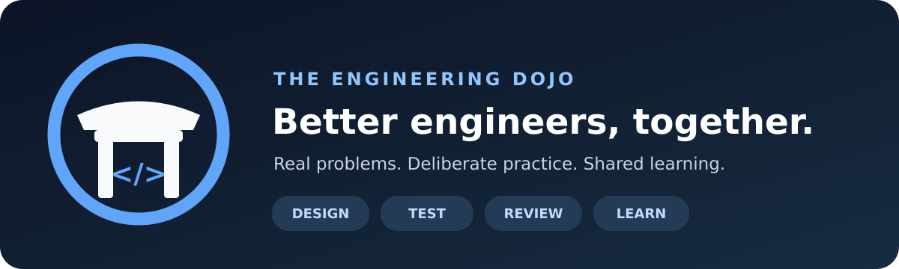
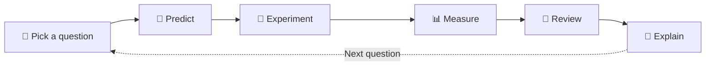

  

  **🥋 A software engineering practice space for curious builders.**

  [📚 Start learning](https://github.com/the-engineering-dojo/engineering-handbook) · [🎟️ Explore the first project](https://github.com/the-engineering-dojo/reservation-engine) · [🤝 How to contribute](https://github.com/the-engineering-dojo/.github/blob/main/CONTRIBUTING.md)

---

## 👋 Why this exists

AI makes generating code easier. **Understanding software engineering still takes practice.**

We're a group of engineers learning together in our spare time: reasoning about correctness, understanding trade-offs, reproducing bugs, reviewing approaches, and sharing what we've learned.

We prioritize **clarity over cleverness**, **evidence over opinions**, and **learning over feature count**.

## 🗺️ Choose your entrance

| 📚 The Library | 🧪 The Playground |
| :--- | :--- |
| **[Engineering Handbook](https://github.com/the-engineering-dojo/engineering-handbook)** | **[Reservation Engine](https://github.com/the-engineering-dojo/reservation-engine)** |
| Learning paths, diagrams, short notes, authoritative resources, and reusable lessons. | A practical case study involving bookings, concurrency, DDD, distributed systems, Docker, Kubernetes, and reliability. |
| [Explore the topics →](https://github.com/the-engineering-dojo/engineering-handbook/blob/main/README.md) | [See the engineering roadmap →](https://github.com/the-engineering-dojo/reservation-engine/blob/main/docs/roadmap.md) |

## 🛣️ Our learning tracks

| Track | Questions we want to answer |
| :--- | :--- |
| 🧠 **Design & DDD** | What belongs in the domain? Where should boundaries be? |
| 🧱 **Databases & concurrency** | How can we prove a seat is never double-booked? |
| 📨 **Distributed systems** | What happens when the network or a worker fails mid-operation? |
| 🐳 **Docker & Kubernetes** | Why deploy multiple replicas? What changes when state is distributed? |
| 🧪 **Testing & quality** | Which tests reveal real risks rather than just raise coverage? |
| 📈 **Performance & observability** | Can we measure bottlenecks before optimizing them? |
| 🔒 **Security & operations** | How do we build systems we can safely run and debug? |

## 🔄 Our practice loop

## 🚦 Current status

**🟡 Planning & learning design.** The initial repositories are a roadmap and collaboration space—not a claim that a production system already exists.

## 🤝 The rules of this dojo

- **People learn, AI assists.** AI usage is welcome when the contributor can explain and verify the result.
- **No cargo-cult complexity.** Start with the simplest sound design; add services and infrastructure to investigate actual trade-offs.
- **Discuss trade-offs kindly.** Review ideas, not people.
- **Share evidence.** Repro steps, diagrams, tests, observations, and concise ADRs beat unsupported claims.
- **Small, sustainable steps.** This is free-time practice, not an always-on workplace.

Want to join or propose an experiment? Read [the contribution guide](https://github.com/the-engineering-dojo/.github/blob/main/CONTRIBUTING.md) and open an issue in the most relevant repository.

Built by people who enjoy figuring out <em>why</em> software works. 🥋